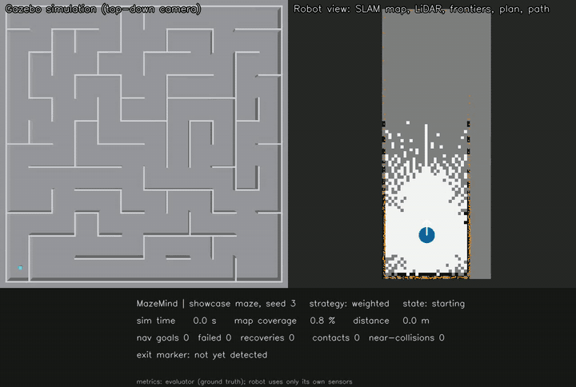
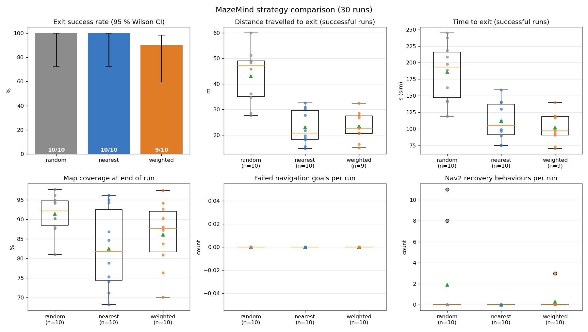

# MazeMind: a robot that escapes mazes it has never seen

**Generate a maze. Drop in a robot with no map. Watch it map, search, find the exit with its camera,
and drive out. Then measure it against ground truth.**

MazeMind is a ROS 2 (Humble) + Gazebo (Fortress) project for **autonomous exploration and escape of
unknown mazes**, entirely in simulation. A custom differential-drive robot builds its own map with
SLAM, picks where to go with a custom frontier-exploration algorithm, recognises the exit marker with
its camera, and stops in front of it. A separate evaluator, the only component that can see ground
truth, scores every run.

<!-- SHOWCASE_START -->


**Featured run ([full video](media/showcase_18m_s3_weighted.mp4), 8× time-lapse):** an **18 m × 18 m
maze with a 12 × 12 grid** (1.5 m cells, 10 % loops, 16 dead ends). The robot started with no map,
explored, recognised the exit marker with its camera and stopped in front of it. It travelled **170 m in
651 simulated seconds** with **0 wall contacts, 0 failed navigation goals and 0 recoveries**. Ground
truth confirmed it ended in the exit cell, 0.63 m from the door.

Left: Gazebo's top-down camera (simulator view). Right: the robot's own SLAM map, rotated to the same
orientation for display, with live LiDAR (orange), frontier targets, the Nav2 plan (green), the travelled
path (cyan) and the exit detection (green star). Bottom: the robot camera with the detector's box, and
live metrics from the ground-truth evaluator.

A second take on the same maze escaped in **134.5 m / 526 s**. Simulator, SLAM and Nav2 timing are not
deterministic, so one maze is not a benchmark. The 60-run comparison below is.
<!-- SHOWCASE_END -->

## Results at a glance

60 runs in the final campaign: 2 maze sizes × 10 seeds × 3 strategies, every run checked against
ground truth.

| Maze | Strategy | Exit reached (verified) | Distance to exit | Time to exit (sim) |
|---|---|---|---|---|
| 4×4 (4 m) | random | 10/10 | 12.5 ± 3.6 m | 61.6 ± 14.0 s |
| 4×4 (4 m) | nearest frontier | 10/10 | 12.5 ± 1.9 m | 67.5 ± 12.5 s |
| 4×4 (4 m) | **weighted (mine)** | 10/10 | **11.1 ± 1.4 m** | **55.2 ± 8.2 s** |
| 6×6 (6 m, loops) | random | 10/10 | 43.0 ± 10.7 m | 186.1 ± 43.3 s |
| 6×6 (6 m, loops) | nearest frontier | 10/10 | 23.0 ± 6.7 m | 111.7 ± 29.3 s |
| 6×6 (6 m, loops) | **weighted (mine)** | 9/10 | 23.4 ± 5.8 m | **102.1 ± 23.1 s** |

* **0 wall contacts and 0 near-collisions (< 5 cm) in all 60 runs**, measured with Gazebo's contact
  sensor and true poses.
* On 6×6 mazes, both informed strategies needed **about half the distance of random** on every paired
  maze (Wilcoxon p ≤ 0.004).
* On 4×4 mazes the weighted score was **faster than nearest-frontier on 10/10 mazes** (p = 0.002) and
  shorter on 8/10 (p = 0.02). On 6×6 mazes it was faster on 7/9 but **not significantly different**
  from nearest-frontier.
* The one failure was perception, not planning: an exit-marker estimate 0.48 m off made the robot stop
  in the cell next to the exit, and the ground-truth check caught it.



Full methodology, paired statistics and failure analysis: [docs/experiments.md](docs/experiments.md).

## How it works

```
LiDAR + wheel odometry ─► SLAM Toolbox map ─► frontiers (LiDAR) + camera-unseen regions
        ─► score: information gain, travel cost, clearance, path safety, revisit/failure memory
        ─► Nav2 (Smac planner + Regulated Pure Pursuit) ─► replan as the map grows
camera ─► green-marker segmentation + LiDAR ranging + 3-frame validation ─► approach exit ─► stop
```

* **The robot never sees the maze.** The generated layout goes only to the evaluator. Ground-truth
  topics live under `/ground_truth/*`, and a unit test fails if exploration code references them.
* **Frontier exploration with memory:** clustering, clearance-aware Dijkstra reachability and cost,
  ray-cast *visible* information gain, a path-bottleneck safety term, revisit/failure penalties,
  blacklisting, stuck detection, early retirement of frontiers the map has already resolved, and
  hysteresis against flip-flopping.
* **Visual search ("camera frontiers"):** a 360° LiDAR maps corridors long before a 75° camera has
  looked down them. The explorer tracks what the *camera* has seen and explores that too. Without
  this, early pilots mapped 94–96 % of a maze and still never saw the exit.
* **Exit recognition:** HSV segmentation, then time-aware fusion with the LiDAR scan for the range,
  then validation over 3 consistent frames. Arrival means "standing in front of the marker", and the
  evaluator independently checks the true pose.

Details: [docs/algorithm.md](docs/algorithm.md) · [docs/architecture.md](docs/architecture.md).

## What you can do

* Generate reproducible mazes (seeded DFS with optional loops) from 3×3 up to the 18 m showcase preset.
* Watch Gazebo and RViz live: SLAM map, LiDAR, frontier clusters, scored targets, camera-unseen
  regions, Nav2 plan, the exit detection, and a live metrics panel.
* Compare `random`, `nearest` and `weighted` exploration on identical seeds with one command, and
  get per-run JSON, CSV, Markdown summaries, paired statistics and plots.
* Record a side-by-side demo video (Gazebo top view next to the robot's own map) straight from
  simulator data, with no screen capture needed.
* Swap in your own frontier heuristic: `Selector.rank()` in `selection.py` receives fully featured
  candidates.

## Quick start

Tested on **Windows 11 + WSL2 Ubuntu 22.04 (WSLg)**, **ROS 2 Humble**, **Gazebo Ignition Fortress
6.18**, Nav2 1.1.20, SLAM Toolbox 2.6.10. Native Ubuntu 22.04 works too (`render_mode:=native`).

```bash
sudo apt install ros-humble-desktop ros-humble-ros-gz ros-humble-navigation2 \
  ros-humble-nav2-bringup ros-humble-slam-toolbox ros-humble-xacro ros-humble-cv-bridge \
  python3-scipy python3-opencv python3-matplotlib python3-pytest rsync ffmpeg
git clone https://github.com/<you>/MazeMind.git && cd MazeMind
bash scripts/build.sh        # builds in ~/mazemind_ws (works from a Windows drive too)
source scripts/env.sh
```

```bash
# Autonomous run with Gazebo + RViz
ros2 launch mazemind_bringup mazemind.launch.py difficulty:=medium seed:=3 strategy:=weighted

# Big maze, headless, record a demo video (8x time-lapse)
ros2 launch mazemind_bringup mazemind.launch.py difficulty:=showcase seed:=3 headless:=true \
  rviz:=false record:=true record_timelapse:=8 record_path:=$MAZEMIND_REPO/media/demo.mp4

# Strategy comparison campaign (fresh simulation per run, resumable) + analysis
ros2 run mazemind_evaluation run_experiments --campaign my_test --difficulty medium --seeds 0 1 2
ros2 run mazemind_evaluation analyze_results results/my_test

# Manual Nav2 check, and printing a maze
ros2 launch mazemind_bringup mazemind.launch.py explore:=false evaluate:=false
python3 scripts/nav_goal.py 1.0 1.0
ros2 run mazemind_simulation generate_maze --difficulty medium --seed 3 --print
```

Main launch arguments: `difficulty` (`tiny|easy|medium|hard|showcase`), `seed`, `strategy`
(`random|nearest|weighted`), `time_limit`, `headless`, `rviz`, `record`, `render_mode`.
WSL rendering problems (Gazebo OGRE crash, white RViz window) are handled automatically and explained in
[docs/troubleshooting.md](docs/troubleshooting.md).

## Tests

```bash
cd src && PYTHONPATH=mazemind_evaluation:mazemind_exploration:mazemind_simulation \
  python3 -m pytest -q mazemind_simulation/test mazemind_exploration/test mazemind_evaluation/test
```

156 tests cover the maze generator, frontiers, planning and traversability, scoring and the
strategies, goal memory, visual coverage, exit perception (synthetic images), ground-truth metrics,
the information boundary, and an **offline end-to-end exploration test** for all three strategies.

## Honest limitations

* **Simulation only.** Wheel odometry is near-ideal on the flat floor, and SLAM loop closure is
  disabled because self-similar corridors caused false closures. Real robots will be harder.
* The exit is a uniquely coloured panel, recognised by colour segmentation, not a learned detector.
* The score weights were set by reasoning, not tuned. With 10 seeds per condition, the
  weighted-vs-nearest comparison on 6×6 mazes is inconclusive.
* About 1 in 60 runs hit a Nav2 lifecycle startup hang. The runner retries these and keeps the failed
  attempt as evidence.

## Repository layout

```
src/mazemind_description   robot URDF/xacro + Gazebo sensors and plugins
src/mazemind_simulation    maze generator, SDF writer, simulation launch
src/mazemind_exploration   frontiers, strategies, visual coverage, explorer + exit detector
src/mazemind_evaluation    evaluator, experiment runner, analysis, demo recorder
src/mazemind_bringup       full-stack launch, Nav2 / SLAM / exploration parameters, RViz
docs/                      architecture, algorithm, experiments, troubleshooting, demo plan
results/                   every campaign: per-run JSON, CSV, summaries, plots (v1, v2, pilots)
media/                     recorded demo video (genuine simulator output)
```

## License

MIT, see [LICENSE](LICENSE).
